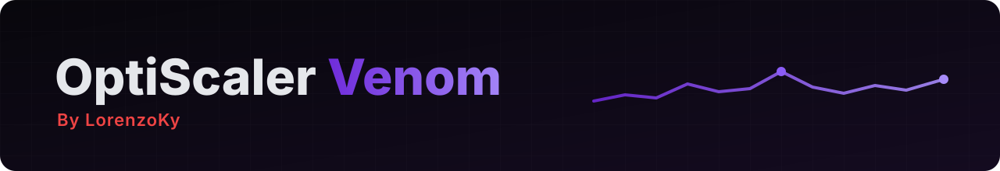

> **Built on OptiScaler `10.0.0.1` (development build, after stable `v0.9.4`)**: the latest official nightly [nightly-20261031](https://github.com/optiscaler/OptiScaler-nightly/releases/tag/nightly-20261031), upstream `master` at [`e7e3872d`](https://github.com/optiscaler/OptiScaler/commit/e7e3872d410f704479d94d318d68d163b6b58947).

An update of v0.2 with everything upstream added since 2026-10-25. Nothing new in the OSD or in the Venom options.

### ✨ What's new
- **Custom upscalers, from OptiScaler itself.** Upstream now loads extra upscaler dlls on DX12 and Vulkan (and custom DLSS-G dlls), so Venom's own **Extra dlls** folder is gone: use the upstream feature, see the [README](https://github.com/LorenzoKy/Optiscaler-Venom#-how-to-use-the-venom-features).
- **FidelityFX SDK 2.4**, with a fallback to the older SDK dll when the new per-feature one isn't there.
- **XeFG fixes** for Dynamic MFG, the game's own FSR FG and AntiLag 2 frame types; FSR FG no longer detected while XeFG runs; FSR FG version switching works while FG is off.
- **XeSS** `MaxResponsiveMaskValue`.
- **Vulkan**: crash in Path of Exile 2 when switching V-Sync fixed, fewer validation errors, NvngxFFX works on Vulkan.
- **OSD**: new Strip preset and *Hide Averages*, centered API row, adjusted defaults, reworked frame time reporting.
- **Games**: Phantom Blade Zero (DLL detection and extended search), FSR 4 hidden from BeamNG.

### ⚠️ Changed
- **Extra dlls removed** (it was Venom's, from v0.2 beta 1): if you used the `OptiScaler/Extra dlls` folder, switch to upstream's custom upscalers. Copies of AMD's driver dll (`amdxcffx64.dll`) aren't loaded from a folder any more.
- The upstream commits after the nightly of 2026-10-31 (for example Pascal running FSR 4, DXGI success statuses on swapchain creation) are not in v0.2.1: they come back with the next official nightly. The Venom nightlies have them.

### 🛟 Who to ask

Open an [issue here](https://github.com/LorenzoKy/Optiscaler-Venom/issues) for any problem with this build. I only handle what is mine (**Venom**): upstream and third-party code is supported by its authors. More in the [README](https://github.com/LorenzoKy/Optiscaler-Venom/blob/main/README.md#-who-to-ask).

| Change | From | Git tag / ref | Ask |
| --- | --- | --- | --- |
| OSD Options, graph switches, PC latency graph, Upscale Inputs, hotspots, FG time, Extra dlls removed | **Venom** | [`opti-venom-v0.2.1`](https://github.com/LorenzoKy/Optiscaler-Venom/releases/tag/opti-venom-v0.2.1) | [@LorenzoKy](https://github.com/LorenzoKy), [issues](https://github.com/LorenzoKy/Optiscaler-Venom/issues) |
| XeFG in Vulkan games | **dashdogy** | [optiscaler/OptiScaler#1240](https://github.com/optiscaler/OptiScaler/pull/1240), commits with `Venom-Part: dashdogy` | [dashdogy](https://github.com/dashdogy) on the PR |
| Everything else | **Upstream** | [nightly-20261031](https://github.com/optiscaler/OptiScaler-nightly/releases/tag/nightly-20261031), `master` [`e7e3872d`](https://github.com/optiscaler/OptiScaler/commit/e7e3872d410f704479d94d318d68d163b6b58947) | [OptiScaler team](https://github.com/optiscaler/OptiScaler/issues) |

Full list in [CHANGELOG-Opti-Venom.md](https://github.com/LorenzoKy/Optiscaler-Venom/blob/opti-venom-v0.2.1/CHANGELOG-Opti-Venom.md).

### 📦 Install
Extract `OptiScaler-Venom_v0.2.1.7z` next to the game's executable and rename `OptiScaler.dll` as usual (e.g. `dxgi.dll`). Updating? Replace the DLL and keep your `OptiScaler.ini`, or take the new one for the new keys' notes. Guide: [OptiScaler wiki](https://github.com/optiscaler/OptiScaler/wiki).
