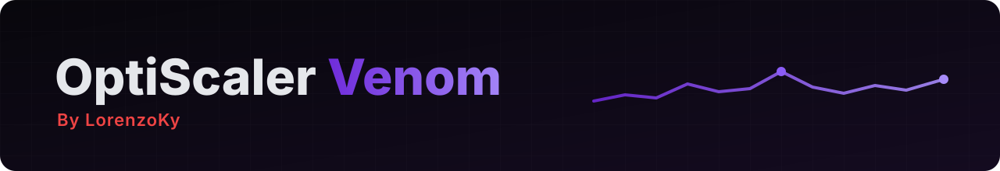

> **Built on OptiScaler `10.0.0.1` (development build, after stable `v0.9.4`)**: the latest official nightly [nightly-20261113](https://github.com/optiscaler/OptiScaler-nightly/releases/tag/nightly-20261113), upstream `master` at [`5f69a25d`](https://github.com/optiscaler/OptiScaler/commit/5f69a25d60cdd4f99d48ea54893972b227ddf583).

v0.3 on top of everything upstream added in the last two weeks. Nothing new in the OSD or in the Venom options.

### ✨ What's new (from upstream)
- **Plugins (ASI)**: they can register custom providers, are loaded at the exe entry again, and the plugin API gets `ReInitUpscalers`, `ComboEx` and `ItemDeactivatedAfterEdit`.
- **Custom DLSSD** support, DLSSD shown as the input for ray reconstruction, and an upscaler can stand in for DLSSD in select games.
- **Dumps on crashes and error exits** (new option) and a *hudless flip* option.
- **Vulkan**: V-Sync override, the swapchain is recreated on suboptimal presents, DLSSG fixes (extra swapchain images from layers, RDNA2/3 glitch workaround, Enabler support), shutdown crash and FG sync fixes.
- **Input**: much more robust menu input (XInput, DirectInput and raw input hooks: no more stuck keys or keys leaking to the game).
- **Compatibility**: ReShade and Special K proxies, Luma, Anti Lag 2 proxy device, FSR 4 kept off non-AMD GPUs unless `Fsr4GpuSupport` is on.
- **Frame generation**: a custom AMD *flip meter* swapchain, Dynamic MFG keeps its back-off across restarts, the FSR FG present callback keeps running while FG is off or paused, and custom DLSSG providers that report no frame generation are ignored.
- **Vulkan FPS limit** no longer divides by the game's own DLSSG count; custom DLL load failures now log the path and the error.
- **Stability**: a long list of fixes for crashes, swapchain resizes, D3D11 FG interop, device lifetimes, NGX and low latency.

### ⚠️ Changed
- Upstream commits after the nightly of 2026-11-13 are not in v0.3.1: they come back with the next official nightly. The Venom nightlies have them.
- Venom itself is the same as v0.3.

### 🛟 Who to ask

Open an [issue here](https://github.com/LorenzoKy/Optiscaler-Venom/issues) for any problem with this build. I only handle what is mine (**Venom**): upstream and third-party code is supported by its authors. More in the [README](https://github.com/LorenzoKy/Optiscaler-Venom/blob/main/README.md#-who-to-ask).

| Change | From | Git tag / ref | Ask |
| --- | --- | --- | --- |
| HDR menu and OSD, Venom presets, XeFG time, CPU sensor notes (as v0.3) | **Venom** | [`opti-venom-v0.3.1`](https://github.com/LorenzoKy/Optiscaler-Venom/releases/tag/opti-venom-v0.3.1) | [@LorenzoKy](https://github.com/LorenzoKy), [issues](https://github.com/LorenzoKy/Optiscaler-Venom/issues) |
| XeFG in Vulkan games | **dashdogy** | [optiscaler/OptiScaler#1240](https://github.com/optiscaler/OptiScaler/pull/1240), commits with `Venom-Part: dashdogy` | [dashdogy](https://github.com/dashdogy) on the PR |
| Everything else | **Upstream** | [nightly-20261113](https://github.com/optiscaler/OptiScaler-nightly/releases/tag/nightly-20261113), `master` [`5f69a25d`](https://github.com/optiscaler/OptiScaler/commit/5f69a25d60cdd4f99d48ea54893972b227ddf583) | [OptiScaler team](https://github.com/optiscaler/OptiScaler/issues) |

Full list in [CHANGELOG-Opti-Venom.md](https://github.com/LorenzoKy/Optiscaler-Venom/blob/opti-venom-v0.3.1/CHANGELOG-Opti-Venom.md).

### 📦 Install
Extract `OptiScaler-Venom_v0.3.1.7z` next to the game's executable and rename `OptiScaler.dll` as usual (e.g. `dxgi.dll`). Updating? Replace the DLL and keep your `OptiScaler.ini`, or take the new one for the new keys' notes. Guide: [OptiScaler wiki](https://github.com/optiscaler/OptiScaler/wiki).
