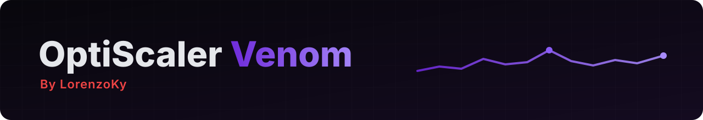

> **Built on OptiScaler `10.0.0.1` (development build, after stable `v0.9.4`)**: the latest official nightly [nightly-20261031](https://github.com/optiscaler/OptiScaler-nightly/releases/tag/nightly-20261031), upstream `master` at [`e7e3872d`](https://github.com/optiscaler/OptiScaler/commit/e7e3872d410f704479d94d318d68d163b6b58947), same upstream as v0.2.1.

HDR done right for the menu and the OSD, plus more precise frame generation time and PC latency.

### ✨ What's new
- **HDR menu and OSD (D3D12).** In games with HDR10 or scRGB output the OptiScaler menu and the OSD no longer look washed out: they're drawn as in SDR and converted to the game's HDR format (203 nits white), with the same colors and transparency as in SDR. Automatic, nothing to set.
- **More accurate frame generation time with XeFG.** XeFG's GPU time is now taken closer to its own work (recent `libxess_fg`), so in theory it's more accurate. Other frame generations are timed as before.
- **PC latency closer to PresentMon.** The input wait pings are paired with the game's frames the way PresentMon does.

### ⚠️ Changed
- **CPU temperature and power** ([#6](https://github.com/LorenzoKy/Optiscaler-Venom/issues/6)): Windows doesn't give them to apps without a kernel driver, so they still need **HWiNFO** (Shared Memory Support on), **MSI Afterburner** (CPU sensors monitored, RTSS not needed), **Core Temp** or **AMD Adrenalin** running. The CPU row tooltip, the ini and the README now say so. GPU sensors work on their own.

### 🐞 Fixed
- The frame generation time could stop updating after XeFG skipped running some of its command lists.

### 🛟 Who to ask

Open an [issue here](https://github.com/LorenzoKy/Optiscaler-Venom/issues) for any problem with this build. I only handle what is mine (**Venom**): upstream and third-party code is supported by its authors. More in the [README](https://github.com/LorenzoKy/Optiscaler-Venom/blob/main/README.md#-who-to-ask).

| Change | From | Git tag / ref | Ask |
| --- | --- | --- | --- |
| HDR menu and OSD, XeFG time, PC latency pings, CPU sensor notes | **Venom** | [`opti-venom-v0.3`](https://github.com/LorenzoKy/Optiscaler-Venom/releases/tag/opti-venom-v0.3) | [@LorenzoKy](https://github.com/LorenzoKy), [issues](https://github.com/LorenzoKy/Optiscaler-Venom/issues) |
| XeFG in Vulkan games | **dashdogy** | [optiscaler/OptiScaler#1240](https://github.com/optiscaler/OptiScaler/pull/1240), commits with `Venom-Part: dashdogy` | [dashdogy](https://github.com/dashdogy) on the PR |
| Everything else | **Upstream** | [nightly-20261031](https://github.com/optiscaler/OptiScaler-nightly/releases/tag/nightly-20261031), `master` [`e7e3872d`](https://github.com/optiscaler/OptiScaler/commit/e7e3872d410f704479d94d318d68d163b6b58947) | [OptiScaler team](https://github.com/optiscaler/OptiScaler/issues) |

Full list in [CHANGELOG-Opti-Venom.md](https://github.com/LorenzoKy/Optiscaler-Venom/blob/opti-venom-v0.3/CHANGELOG-Opti-Venom.md).

### 📦 Install
Extract `OptiScaler-Venom_v0.3.7z` next to the game's executable and rename `OptiScaler.dll` as usual (e.g. `dxgi.dll`). Updating? Replace the DLL and keep your `OptiScaler.ini`: there are no new keys. Guide: [OptiScaler wiki](https://github.com/optiscaler/OptiScaler/wiki).
