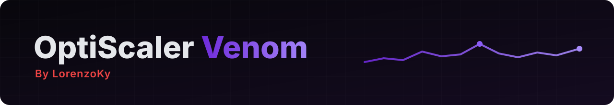

> **Built on OptiScaler `10.0.0.1` (development build, after stable `v0.9.4`)**: the latest official nightly [nightly-20261115](https://github.com/optiscaler/OptiScaler-nightly/releases/tag/nightly-20261115), upstream `master` at [`ccf3b8c6`](https://github.com/optiscaler/OptiScaler/commit/ccf3b8c6a75824d0c9c7cc7156bf666afddde3cc), the same as v0.4.

Fixes for v0.4: Neural sharpening no longer washes the image out, the Venom presets are no longer too small, and the sharpener's GPU time has its real name.

### 🩹 Fixed
- **Neural sharpening washed the image out** in games that send the upscaler a float image from before their tonemapper without saying it's HDR (seen in Marvel's Spider-Man 2, `R11G11B10_FLOAT` through FFX): it was clamped to 1.0, which cut every highlight before the game's exposure and bloom, so blacks rose and colors faded. Float images now take the linear path, like HDR ones, and keep their highlights; 8 and 10 bit images stay as before.
- **Neural sharpening greyed colors**: the sharpened luma was added to the three channels alike, which mixes grey into linear colors. Now every channel is scaled by the same amount, like RCAS, so hue and saturation stay; near black pixels get at most twice as bright, so their noise doesn't turn into colored dots.
- **Venom presets too small**: *Venom*, *Venom Style*, *Venom Strip* and *Hybrid* forced the OSD scale to 1.0, smaller than the other presets above 1080p (the menu scale is 1.3 at 1440p). They now follow the menu scale; every other setting is still set by the preset.
- **Per shader GPU times** showed every sharpener as *RCAS*: the time is now listed under the shader that ran (*RCAS*, *Depth Aware (RCAS)*, *Depth Aware (DAS)* or *Neural*). It was already measuring the right shader.

### ⚠️ Changed
- The log says once which format Neural sharpening gets and how it handles it (`Neural sharpening input format: ...`).

### 🔄 Upgrading
- Replace the DLL: ini files and settings codes keep working, no new keys. Apply a Venom preset again to get its new size.

### 🛟 Who to ask

Open an [issue here](https://github.com/LorenzoKy/Optiscaler-Venom/issues) for any problem with this build. I only handle what is mine (**Venom**): upstream and third-party code is supported by its authors. More in the [README](https://github.com/LorenzoKy/Optiscaler-Venom/blob/main/README.md#-who-to-ask).

| Change | From | Git tag / ref | Ask |
| --- | --- | --- | --- |
| Neural sharpening fixes, Venom preset scale, sharpener GPU time name, plus everything of v0.4 | **Venom** | [`opti-venom-v0.4.1`](https://github.com/LorenzoKy/Optiscaler-Venom/releases/tag/opti-venom-v0.4.1) | [@LorenzoKy](https://github.com/LorenzoKy), [issues](https://github.com/LorenzoKy/Optiscaler-Venom/issues) |
| XeFG in Vulkan games | **dashdogy** | [optiscaler/OptiScaler#1240](https://github.com/optiscaler/OptiScaler/pull/1240), commits with `Venom-Part: dashdogy` | [dashdogy](https://github.com/dashdogy) on the PR |
| Everything else | **Upstream** | [nightly-20261115](https://github.com/optiscaler/OptiScaler-nightly/releases/tag/nightly-20261115), `master` [`ccf3b8c6`](https://github.com/optiscaler/OptiScaler/commit/ccf3b8c6a75824d0c9c7cc7156bf666afddde3cc) | [OptiScaler team](https://github.com/optiscaler/OptiScaler/issues) |

Full list in [CHANGELOG-Opti-Venom.md](https://github.com/LorenzoKy/Optiscaler-Venom/blob/opti-venom-v0.4.1/CHANGELOG-Opti-Venom.md).

### 📦 Install
Extract `OptiScaler-Venom_v0.4.1.7z` next to the game's executable and rename `OptiScaler.dll` as usual (e.g. `dxgi.dll`). Updating? Replace the DLL and keep your `OptiScaler.ini`. Guide: [OptiScaler wiki](https://github.com/optiscaler/OptiScaler/wiki).
