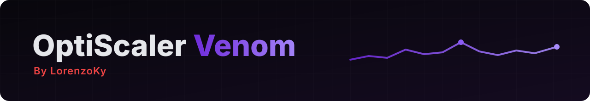

> **Built on OptiScaler `10.0.0.1` (development build, after stable `v0.9.4`)**: the latest official nightly [nightly-20261116](https://github.com/optiscaler/OptiScaler-nightly/releases/tag/nightly-20261116), upstream `master` at [`1e568bb3`](https://github.com/optiscaler/OptiScaler/commit/1e568bb3df081988416b8aa85fa4efe0b22c58cf).

Built on nightly-20261116 with Neural (BaBa) hardening for linear/HDR & colors, Vulkan/fallback robustness, upstream menu/INI naming alignment, and per-shader GPU time naming.

### 🩹 Fixed
- **Flat-patch bias on Neural (BaBa) sharpening**: subtracts the network's non-zero response on a uniform 3x3 patch (`RunNetFlat`), so dark linear pre-tonemap areas aren't lifted.
- **Neural (BaBa) linear/HDR stability and color fidelity**: guards the `groupshared` luma tile against Inf/NaN, safely bounds `EncodeLuma` / `DecodeLuma`, adds a local 3x3 perceptual limiter and HDR floor gain to avoid dark rings, keeps wide-gamut negative scRGB channels intact, prevents clipping/grey wash on saturated LDR colors, and excludes non-float HDR10 PQ inputs from the linear path.
- **Vulkan, fallback & MV safety**: compiles SPIR-V with `-fspv-use-unknown-image-format`, falls back cleanly to RCAS on DX11, DX12 and Vulkan when the neural shader is unavailable, scales both MV axes independently, and skips MAS when motion dimensions are zero.
- **Per shader GPU times**: lists the time under the active sharpener's upstream name (*RCAS*, *Depth Aware (RCAS)*, *Depth Aware (DAS)*, or *Neural (BaBa)*) instead of always *RCAS*.

### ⚠️ Changed
- **Upstream menu & INI naming alignment**: matches upstream's `"Neural (BaBa)"` method/GPU timing label, `"Neural Sharpening Parameters"`, `Shader=baba`, `BabaModel`, `BabaEdgeResponse`, `"Clamp Output"` (auto-defaulting based on linear/HDR detection), and clamped *Edge Response*. Existing Venom INI keys (`Shader=neural`, `NeuralModel`, `NeuralEdgeResponse`) are still read automatically.

### 🔄 Upgrading
- Replace the DLL: existing `OptiScaler.ini` files (whether using `Shader=baba` or older Venom `Shader=neural`) keep working without manual edits.

### 🛟 Who to ask

Open an [issue here](https://github.com/LorenzoKy/Optiscaler-Venom/issues) for any problem with this build. I only handle what is mine (**Venom**): upstream and third-party code is supported by its authors. More in the [README](https://github.com/LorenzoKy/Optiscaler-Venom/blob/main/README.md#-who-to-ask).

| Change | From | Git tag / ref | Ask |
| --- | --- | --- | --- |
| Neural (BaBa) hardening, fallback & naming alignment, GPU time shader name, plus everything of v0.4.1 | **Venom** | [`opti-venom-v0.4.2`](https://github.com/LorenzoKy/Optiscaler-Venom/releases/tag/opti-venom-v0.4.2) | [@LorenzoKy](https://github.com/LorenzoKy), [issues](https://github.com/LorenzoKy/Optiscaler-Venom/issues) |
| XeFG in Vulkan games | **dashdogy** | [optiscaler/OptiScaler#1240](https://github.com/optiscaler/OptiScaler/pull/1240), commits with `Venom-Part: dashdogy` | [dashdogy](https://github.com/dashdogy) on the PR |
| Everything else | **Upstream** | [nightly-20261116](https://github.com/optiscaler/OptiScaler-nightly/releases/tag/nightly-20261116), `master` [`1e568bb3`](https://github.com/optiscaler/OptiScaler/commit/1e568bb3df081988416b8aa85fa4efe0b22c58cf) | [OptiScaler team](https://github.com/optiscaler/OptiScaler/issues) |

Full list in [CHANGELOG-Opti-Venom.md](https://github.com/LorenzoKy/Optiscaler-Venom/blob/opti-venom-v0.4.2/CHANGELOG-Opti-Venom.md).

### 📦 Install
Extract `OptiScaler-Venom_v0.4.2.7z` next to the game's executable and rename `OptiScaler.dll` as usual (e.g. `dxgi.dll`). Updating? Replace the DLL and keep your `OptiScaler.ini`. Guide: [OptiScaler wiki](https://github.com/optiscaler/OptiScaler/wiki).
