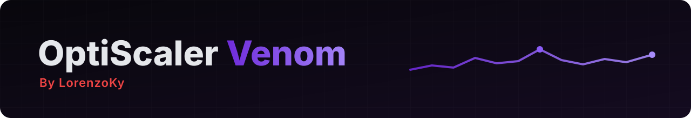

> **Built on OptiScaler `10.0.0.1` (development build, after stable `v0.9.4`)**: the latest official nightly [nightly-20261119](https://github.com/optiscaler/OptiScaler-nightly/releases/tag/nightly-20261119), upstream `master` at [`4a8d55a9`](https://github.com/optiscaler/OptiScaler/commit/4a8d55a9dc5ebdc802805188c4460dc6f544bc3e).

Rebased on `nightly-20261119`, dropping Venom's custom Neural (BaBa) changes in favor of upstream's sharpening implementations.

### ⚠️ Changed
- **Neural sharpening left to upstream**: removed Venom's Neural (BaBa) port, shader changes, legacy `Shader=neural` / `NeuralModel` / `NeuralEdgeResponse` INI fallback keys, and Venom's separate per-shader GPU time naming patch (now integrated upstream). Sharpening uses upstream's **Neural (BaBa)** and **OptiSharpen** directly.

### 🆕 From upstream (nightly-20261119)
- **Sharpening**: upstream **Neural (BaBa)** (`Shader=baba`) with groupshared luma tile, piecewise linear flat-patch correction, per-axis motion vector mapping, and alpha preservation in debug views; new **OptiSharpen** neural sharpener (`Shader=opti`, models 0–5); per-shader GPU timing labels (`RCAS`, `Depth Aware (RCAS)`, `Depth Aware (DAS)`, `Neural (BaBa)`, `OptiSharpen`).
- **Inputs & compatibility**: depth and motion vector extraction for XeSS inputs in Unreal Engine games, updated FSR 3.1 stability preset values, Streamline using ReShade's proxy device when OptiScaler loaded ReShade, disabled FSR-FG Vulkan version query at init (fixes *Doom: The Dark Ages* hang), and hidden log messages for redirected NVAPI calls.

### 🔄 Upgrading
- Replace the DLL. Note: old Venom INI keys (`[Sharpness] Shader=neural`, `NeuralModel`, `NeuralEdgeResponse`) are no longer read; use upstream's `Shader=baba` (`BabaModel`, `BabaEdgeResponse`, `BabaDebugView`) or `Shader=opti` (`OptiSharpenModel`, `OptiSharpenDebugView`).

### 🛟 Who to ask

Open an [issue here](https://github.com/LorenzoKy/Optiscaler-Venom/issues) for any problem with this build. I only handle what is mine (**Venom**): upstream and third-party code is supported by its authors. More in the [README](https://github.com/LorenzoKy/Optiscaler-Venom/blob/main/README.md#-who-to-ask).

| Change | From | Git tag / ref | Ask |
| --- | --- | --- | --- |
| OSD features, FG time, D3D12 HDR menu/OSD, presets | **Venom** | [`opti-venom-v0.4.3`](https://github.com/LorenzoKy/Optiscaler-Venom/releases/tag/opti-venom-v0.4.3) | [@LorenzoKy](https://github.com/LorenzoKy), [issues](https://github.com/LorenzoKy/Optiscaler-Venom/issues) |
| XeFG in Vulkan games | **dashdogy** | [optiscaler/OptiScaler#1240](https://github.com/optiscaler/OptiScaler/pull/1240), commits with `Venom-Part: dashdogy` | [dashdogy](https://github.com/dashdogy) on the PR |
| Neural (BaBa), OptiSharpen, and everything else | **Upstream** | [nightly-20261119](https://github.com/optiscaler/OptiScaler-nightly/releases/tag/nightly-20261119), `master` [`4a8d55a9`](https://github.com/optiscaler/OptiScaler/commit/4a8d55a9dc5ebdc802805188c4460dc6f544bc3e) | [OptiScaler team](https://github.com/optiscaler/OptiScaler/issues) |

Full list in [CHANGELOG-Opti-Venom.md](https://github.com/LorenzoKy/Optiscaler-Venom/blob/opti-venom-v0.4.3/CHANGELOG-Opti-Venom.md).

### 📦 Install
Extract `OptiScaler-Venom_v0.4.3.7z` next to the game's executable and rename `OptiScaler.dll` as usual (e.g. `dxgi.dll`). Updating? Replace the DLL and keep your `OptiScaler.ini`. Guide: [OptiScaler wiki](https://github.com/optiscaler/OptiScaler/wiki).
