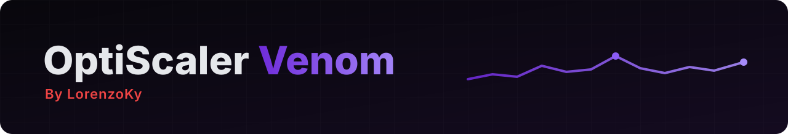

> **Built on OptiScaler `10.0.0.1` (development build, after stable `v0.9.4`)**: the latest official nightly [nightly-20261115](https://github.com/optiscaler/OptiScaler-nightly/releases/tag/nightly-20261115), upstream `master` at [`ccf3b8c6`](https://github.com/optiscaler/OptiScaler/commit/ccf3b8c6a75824d0c9c7cc7156bf666afddde3cc).

A new sharpener that leaves the HUD alone, an FPS row without the base frame rate if you want it, and Venom presets that set the whole OSD in one click.

### ✨ What's new
- **Neural sharpening**: Sharpness → Method → **Neural (Barbatos)**. A small neural network, ported from Barbatos' *Neural Sharpen* for ReShade (MIT), that only touches the luma and skips aliased edges and fireflies. It sharpens the upscaler's output, **before the game draws its HUD**, so menus and text stay as they are. Two trained models (A: standard, B: edge-enhanced) and an **Edge Response** slider; Motion Adaptive Sharpness works with it. HDR games are handled (the network works on perceptual luma). D3D11, D3D12 and Vulkan. Strength 0.5 is the ReShade default.
- **Base FPS switch** (OSD Options → FPS & Upscale → **Base FPS**): with frame generation the FPS row shows `120.0/60.0` (output/real). Turn it off to see only the output frame rate, generated frames included.
- **Venom presets reworked** (Appearance → Presets): every Venom preset now sets **every** OSD setting (type, rows, scale, position, font, text, colors, background, shadow, metrics, graphs), so it looks the same whatever you had before, and always switches the overlay to **Custom**.
  - *Venom*: every metric, clean Segoe UI on a dark panel, frame time graph.
  - *Venom Style*: every metric in venom green, frame time, FG time and latency graphs, hardware names, session timer.
  - *Venom Strip* (new): the metrics that matter while playing, in one compact strip at the top center.
  - *Hybrid* (new): every metric in Hybrid Launcher's colors, crimson, ivory and charcoal.

### 🆕 From upstream (nightly-20261115)
- **Frame generation**: base FPS measured with Nvngx FG as input, Nvngx FG in the Status tab, Unity FG settings, a crash on exit with Nvngx FG replacements fixed, DLSSG options taken from the Streamline plugin in use.
- **DLSS subrects**: cropped for the FFX / FSR 2 / FSR 3.1 backends on D3D11, D3D12, Vulkan and the D3D11-on-D3D12 bridge, output placed at its base; Split Fiction pads smaller upscale sizes.
- **Compatibility**: NVIDIA GPUs without a display on dxvk-nvapi (Wine), Optimus queue check, no exe entry hook with TLS callbacks, more game quirks (BeamNG, Split Fiction), clearer spoof status.
- **Stability**: D3D11 resource copy and shader view fixes, the Dx11wDx12 FG swapchain keeps the game's color space, no loader lock under a Streamline mutex, the ini's documented defaults match the code.

### ⚠️ Changed
- Upstream's resource copy shader replaced the one dashdogy's Vulkan XeFG changed: the same fix (storage image without a fixed format) moved to the new shader.
- Upstream commits after the nightly of 2026-11-15 are not in v0.4: they come with the next official nightly. The Venom nightlies follow every new official nightly, checked every 10 minutes.

### 🔄 Upgrading
- Replace the DLL: ini files and settings codes keep working. New keys: `[Sharpness] Shader=neural`, `[CAS] NeuralModel`, `NeuralEdgeResponse`, `[Menu] FpsOverlayShowBaseFps`. Take the new `OptiScaler.ini` for their notes.

### 🛟 Who to ask

Open an [issue here](https://github.com/LorenzoKy/Optiscaler-Venom/issues) for any problem with this build. I only handle what is mine (**Venom**): upstream and third-party code is supported by its authors. More in the [README](https://github.com/LorenzoKy/Optiscaler-Venom/blob/main/README.md#-who-to-ask).

| Change | From | Git tag / ref | Ask |
| --- | --- | --- | --- |
| Neural sharpening (port; network and weights by [Barbatos](https://github.com/BarbatosAWLS/Reshade-Shaders), MIT), Base FPS switch, reworked Venom presets, Venom Strip and Hybrid, plus everything of v0.3.1 | **Venom** | [`opti-venom-v0.4`](https://github.com/LorenzoKy/Optiscaler-Venom/releases/tag/opti-venom-v0.4) | [@LorenzoKy](https://github.com/LorenzoKy), [issues](https://github.com/LorenzoKy/Optiscaler-Venom/issues) |
| XeFG in Vulkan games | **dashdogy** | [optiscaler/OptiScaler#1240](https://github.com/optiscaler/OptiScaler/pull/1240), commits with `Venom-Part: dashdogy` | [dashdogy](https://github.com/dashdogy) on the PR |
| Everything else | **Upstream** | [nightly-20261115](https://github.com/optiscaler/OptiScaler-nightly/releases/tag/nightly-20261115), `master` [`ccf3b8c6`](https://github.com/optiscaler/OptiScaler/commit/ccf3b8c6a75824d0c9c7cc7156bf666afddde3cc) | [OptiScaler team](https://github.com/optiscaler/OptiScaler/issues) |

Full list in [CHANGELOG-Opti-Venom.md](https://github.com/LorenzoKy/Optiscaler-Venom/blob/opti-venom-v0.4/CHANGELOG-Opti-Venom.md).

### 📦 Install
Extract `OptiScaler-Venom_v0.4.7z` next to the game's executable and rename `OptiScaler.dll` as usual (e.g. `dxgi.dll`). Updating? Replace the DLL and keep your `OptiScaler.ini`, or take the new one for the new keys' notes. Guide: [OptiScaler wiki](https://github.com/optiscaler/OptiScaler/wiki).
