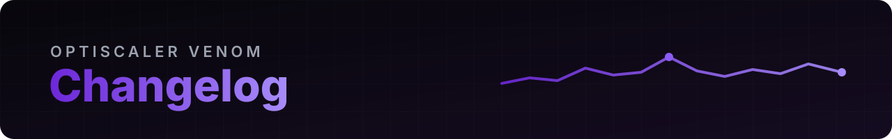

  

 

Changes of OptiScaler Venom compared to upstream [OptiScaler](https://github.com/optiscaler/OptiScaler). For upstream's own changes see [Changelog.md](Changelog.md) and the [OptiScaler releases](https://github.com/optiscaler/OptiScaler/releases).

## Nightly builds

Automatic and **not tested**: the official OptiScaler nightly of the day plus the Venom changes (see the [README](README.md#-nightly-builds-always-up-to-date-not-tested)). Newest first; each line is added by the build itself. Dates are UTC.

| Build | Upstream nightly | Upstream commit (date) | Venom commit (date) |
| --- | --- | --- | --- |
<!-- nightly-rows -->
| `opti-venom-nightly-20261024` | [nightly-20261024](https://github.com/optiscaler/OptiScaler-nightly/releases/tag/nightly-20261024) (2026-10-24) | [`fd3a45a6`](https://github.com/optiscaler/OptiScaler/commit/fd3a45a6cac6d610a35c570479f80dae95ca4eac) (2026-10-23) | [`8037f10a`](https://github.com/LorenzoKy/OptiScaler/commit/8037f10a7a5ce960493e6174902dfb85b5b2ea16) (2026-10-24) |

## Venom v0.1 (2026-10-24)

> **Built on OptiScaler `10.0.0.1` (development build, after stable `v0.9.4`)**
> Upstream `master` at commit [`539c9a1e`](https://github.com/optiscaler/OptiScaler/commit/539c9a1ecd2c37bee1980d0f0645919cab837855) "Make FFX Vk hooking side match the Dx12 side", 2026-10-24.
> It includes everything in the official nightly of that day.

First release. Upstream OptiScaler plus a reworked FPS overlay. With default settings the overlay looks and behaves like upstream's.

### New overlay metrics
- **Average, 1% low and 0.1% low FPS** on the FPS row (last 1000 and 5000 frames).
- **PC latency** (experimental), estimated like FrameView and PresentMon: from the input to the end of every shown frame, generated frames included, timed with GPU timestamps on D3D12. Uses the game's Reflex, XeLL or AntiLag 2 markers and PC Latency pings.
- **Render latency**: from simulation start to the end of the frame's GPU work. Show PC latency, render latency or both.
- **Bottleneck**: GPU Bound, CPU Bound, FPS Limit or Refresh Limit (V-Sync). Decided from the GPU's usage and how long the CPU waits for the GPU; a game's own FPS limit through Reflex, XeLL or AntiLag 2 shows as FPS Limit.
- **Real refresh rate** and its average (experimental), from the display's vertical blanks (follows VRR).
- **VRAM**: the game's use, the budget Windows gives it and the memory clock.
- **GPU** and **CPU**: temperature, power, voltage, clock, optionally with the model name and the **usage %** (as Task Manager shows it, any GPU vendor).
- **RAM**: system use, the game's working set, commit charge.
- **Date & Time** row in your Windows format, with an optional **session timer** (time since OptiScaler started).
- **Upscale ratio row** now also shows the upscaler, the FSR 4 model and preset, or the overridden DLSS preset.
- **Upscaler FPS cost**: the FPS the upscaler's GPU time takes away.
- Frame time and upscaler time rows can be shown or hidden on any overlay type.

### Customization
- Position: the 4 corners, top/bottom center, or any custom X/Y.
- Scale up to 3.0, independent from the menu scale.
- Font (any installed font or file), font size, letter spacing, label and value size.
- Label, value, graph and background colors; shadow or outline with strength and color; corner radius; graph height; row spacing.
- Row order, compact labels (UPS, PCL, FT...), update interval to make fast-changing values readable.
- **Presets**: Opti-Like, Afterburner-Like, Latency Lab, each with a readable font size.
- **Share Settings**: copy and paste the whole overlay setup as a code.
- Menu corner radius (`Rounding`).
- All of it is in the menu and documented in `OptiScaler.ini` (`FpsOverlay*` keys).

### Known limits
- PC latency and the refresh rate row are experimental. PC latency doesn't see the display's flip: expect a few ms of difference from FrameView or PresentMon. Without latency markers it falls back to an estimate.
- Hardware telemetry depends on what the GPU driver and the system expose: some values may be missing on some setups. CPU temperature and power may need HWiNFO, Afterburner or Core Temp running.
- An in-game FPS cap that doesn't go through Reflex, XeLL or AntiLag 2 shows as CPU Bound.
