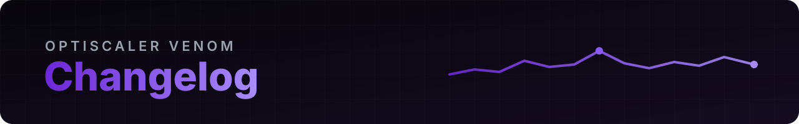

  

 

What OptiScaler Venom changes compared to upstream [OptiScaler](https://github.com/optiscaler/OptiScaler), release by release (upstream's own changes: [Changelog.md](Changelog.md) and the [OptiScaler releases](https://github.com/optiscaler/OptiScaler/releases)). Dates are UTC. Talk about Venom and share OSD codes in the [Opti Venom thread on Discord](https://discord.com/channels/995299945492008990/1563930670018076843).

**Who to ask.** Problems with a Venom build go to the [issues](https://github.com/LorenzoKy/Optiscaler-Venom/issues). [@LorenzoKy](https://github.com/LorenzoKy) only supports **Venom** code; **Upstream** code is the [OptiScaler team](https://github.com/optiscaler/OptiScaler/issues)'s, third-party code (today **dashdogy**) its author's. Each release ends with a table saying whose each change is; the full list is in the [README](https://github.com/LorenzoKy/Optiscaler-Venom/blob/main/README.md#-whats-different).

| Release | Date | Built on upstream | |
| --- | --- | --- | --- |
| [**v0.3**](#v03) · [`opti-venom-v0.3`](https://github.com/LorenzoKy/Optiscaler-Venom/releases/tag/opti-venom-v0.3) | 2026-11-01 | [nightly-20261031](https://github.com/optiscaler/OptiScaler-nightly/releases/tag/nightly-20261031) = [`e7e3872d`](https://github.com/optiscaler/OptiScaler/commit/e7e3872d410f704479d94d318d68d163b6b58947) (2026-10-29) | Latest |
| [v0.2.1](#v021) · [`opti-venom-v0.2.1`](https://github.com/LorenzoKy/Optiscaler-Venom/releases/tag/opti-venom-v0.2.1) | 2026-10-31 | [nightly-20261031](https://github.com/optiscaler/OptiScaler-nightly/releases/tag/nightly-20261031) = [`e7e3872d`](https://github.com/optiscaler/OptiScaler/commit/e7e3872d410f704479d94d318d68d163b6b58947) (2026-10-29) |  |
| [v0.2](#v02) · [`opti-venom-v0.2`](https://github.com/LorenzoKy/Optiscaler-Venom/releases/tag/opti-venom-v0.2) | 2026-10-25 | [nightly-20261025](https://github.com/optiscaler/OptiScaler-nightly/releases/tag/nightly-20261025) = [`08e13adf`](https://github.com/optiscaler/OptiScaler/commit/08e13adf55b3fd71a67071eac2e95973ac598df3) (2026-10-24) |  |
| [v0.2 beta 4](#v02-beta-4) · [`opti-venom-v0.2-beta4`](https://github.com/LorenzoKy/Optiscaler-Venom/releases/tag/opti-venom-v0.2-beta4) | 2026-10-25 | [`3c6263ec`](https://github.com/optiscaler/OptiScaler/commit/3c6263ec815fd50c09821cbfcf1411d77cb99396) (2026-10-25) | |
| [v0.2 beta 3](#v02-beta-3) · [`opti-venom-v0.2-beta3`](https://github.com/LorenzoKy/Optiscaler-Venom/releases/tag/opti-venom-v0.2-beta3) | 2026-10-25 | [`3c6263ec`](https://github.com/optiscaler/OptiScaler/commit/3c6263ec815fd50c09821cbfcf1411d77cb99396) (2026-10-25) | |
| [v0.2 beta 2](#v02-beta-2) · [`opti-venom-v0.2-beta2`](https://github.com/LorenzoKy/Optiscaler-Venom/releases/tag/opti-venom-v0.2-beta2) | 2026-10-25 | [`08e13adf`](https://github.com/optiscaler/OptiScaler/commit/08e13adf55b3fd71a67071eac2e95973ac598df3) (2026-10-24) | |
| [v0.2 beta 1](#v02-beta-1) · [`opti-venom-v0.2-beta1`](https://github.com/LorenzoKy/Optiscaler-Venom/releases/tag/opti-venom-v0.2-beta1) | 2026-10-24 | [`539c9a1e`](https://github.com/optiscaler/OptiScaler/commit/539c9a1ecd2c37bee1980d0f0645919cab837855) (2026-10-24) | Pre-release |
| [v0.1](#v01) · [`opti-venom-v0.1`](https://github.com/LorenzoKy/Optiscaler-Venom/releases/tag/opti-venom-v0.1) | 2026-10-24 | [`539c9a1e`](https://github.com/optiscaler/OptiScaler/commit/539c9a1ecd2c37bee1980d0f0645919cab837855) (2026-10-24) | |

Daily automatic builds, not tested, are listed under [Nightly builds](#nightly-builds).

---

## v0.3

> OptiScaler `10.0.0.1` (development build after `v0.9.4`), built on the latest official nightly [nightly-20261031](https://github.com/optiscaler/OptiScaler-nightly/releases/tag/nightly-20261031) = upstream `master` [`e7e3872d`](https://github.com/optiscaler/OptiScaler/commit/e7e3872d410f704479d94d318d68d163b6b58947), same upstream as v0.2.1.

### New
- **HDR menu and OSD** (D3D12): with HDR10 or scRGB output the OptiScaler menu and the OSD are drawn as in SDR and then converted to the game's HDR format (203 nits white), blended over the game like in SDR. Before they looked washed out. Automatic, no setting.
- **Venom presets** (Appearance → Presets): *Venom* turns on every Venom row (FPS with lows, upscaler, PC and render latency, FG time, bottleneck, VRAM, GPU, CPU and RAM with usage and hotspots); *Venom Style* shows the same metrics with a look of its own (Segoe UI Semibold, venom green labels, soft shadow, dark rounded panel). One click, nothing else to set.

### Changed
- **Frame generation time**: XeFG's time is now taken closer to its own GPU work (recent `libxess_fg`), so in theory it's more accurate. Other frame generations and older `libxess_fg` are timed as before.
- **CPU sensors** ([#6](https://github.com/LorenzoKy/Optiscaler-Venom/issues/6)): CPU temperature and power still need HWiNFO, MSI Afterburner, Core Temp or AMD Adrenalin running, because Windows has no CPU sensors without a kernel driver. The CPU row tooltip, the ini, the log and the README now say so.

### Fixed
- The frame generation time could stop updating after XeFG skipped running some of its command lists.

### Upgrading
- Nothing to do: ini files and settings codes keep working, no new keys.

### Known limits
- HDR conversion is D3D12 only; D3D11 and Vulkan games keep the previous HDR colors. HLG output isn't converted.

### Who to ask

| Change | From | Ask |
| --- | --- | --- |
| HDR menu and OSD, Venom presets, XeFG time, CPU sensor notes | **Venom** | [@LorenzoKy](https://github.com/LorenzoKy), [issues](https://github.com/LorenzoKy/Optiscaler-Venom/issues) |
| XeFG in Vulkan games | **dashdogy** | [dashdogy](https://github.com/dashdogy) on [PR #1240](https://github.com/optiscaler/OptiScaler/pull/1240) |
| Everything else | **Upstream** nightly-20261031 `e7e3872d` | [OptiScaler team](https://github.com/optiscaler/OptiScaler/issues) |

## v0.2.1

> OptiScaler `10.0.0.1` (development build after `v0.9.4`), built on the latest official nightly [nightly-20261031](https://github.com/optiscaler/OptiScaler-nightly/releases/tag/nightly-20261031) = upstream `master` [`e7e3872d`](https://github.com/optiscaler/OptiScaler/commit/e7e3872d410f704479d94d318d68d163b6b58947). v0.2 plus everything upstream added since 2026-10-25.

### Changed
- **Extra dlls removed**: upstream OptiScaler now loads custom upscaler dlls on DX12 and Vulkan (and custom DLSS-G dlls) by itself, so Venom's own folder is gone. Copies of AMD's driver dll (`amdxcffx64.dll`) aren't loaded from a folder any more.
- The upstream commits after nightly-20261031 are not in v0.2.1: they come back with the next official nightly. Venom nightlies have them.

### From upstream (nightly-20261031)
- Custom upscaler dlls (DX12, FFX Vulkan) and custom DLSS-G dlls, FidelityFX SDK 2.4, XeSS `MaxResponsiveMaskValue`.
- XeFG fixes for Dynamic MFG, the game's FSR FG and AntiLag 2; Path of Exile 2 V-Sync crash on Vulkan; NvngxFFX on Vulkan.
- OSD: Strip preset, Hide Averages, reworked frame time reporting.
- Game fixes: Phantom Blade Zero, BeamNG (FSR 4 hidden).

### Upgrading
- Nothing to do: ini files and settings codes keep working. If you used `OptiScaler/Extra dlls`, switch to upstream's custom upscalers (see the [README](README.md)).

### Who to ask

| Change | From | Ask |
| --- | --- | --- |
| Extra dlls removed | **Venom** | [@LorenzoKy](https://github.com/LorenzoKy), [issues](https://github.com/LorenzoKy/Optiscaler-Venom/issues) |
| XeFG in Vulkan games | **dashdogy** | [dashdogy](https://github.com/dashdogy) on [PR #1240](https://github.com/optiscaler/OptiScaler/pull/1240) |
| Everything else | **Upstream** nightly-20261031 `e7e3872d` | [OptiScaler team](https://github.com/optiscaler/OptiScaler/issues) |

## v0.2

> OptiScaler `10.0.0.1` (development build after `v0.9.4`), built on the latest official nightly [nightly-20261025](https://github.com/optiscaler/OptiScaler-nightly/releases/tag/nightly-20261025) = upstream `master` [`08e13adf`](https://github.com/optiscaler/OptiScaler/commit/08e13adf55b3fd71a67071eac2e95973ac598df3). From now on releases are built on the latest official nightly, not on newer upstream commits. First stable v0.2: everything from beta 1 to 4, plus:

### New
- **OSD Options** (was Row Options), in three columns: FPS & Upscale, Hardware, Graphs.
- **Graph switches** in OSD Options, one per graph (`FpsOverlayShowFrameTimeGraph`, `...UpscalerTimeGraph`, `...FGTimeGraph`, on by default like OptiScaler). Graphs are no longer rows of their own: each one shows under its row.
- **PC latency graph** (`FpsOverlayShowLatencyGraph`, off by default): the last 18 seconds of the latency row, under it.
- **Upscale Inputs** (was Upscaler Name): `DLSS -> FSR 4.0.3` goes on the Upscale Ratio row when it's shown, else on the FPS row as before.

### Removed
- **Refresh Rate / VRR** row: not accurate enough. `FpsOverlayShowRefreshRate` and the `refresh` row are ignored.

### Changed
- The upstream commits after nightly-20261025 that beta 3 and 4 had (XeFG Dynamic MFG and FSR FG fixes, AntiLag 2 frame types, Path of Exile 2 V-Sync crash fix, lighter OSD defaults) are not in v0.2: they come back with the next official nightly. Venom nightlies have them.

### Upgrading
- Nothing to do: old ini files and settings codes keep working. Graph entries in `FpsOverlayRows` (`frametimegraph`...) are ignored: use the graph switches.

### Who to ask

| Change | From | Ask |
| --- | --- | --- |
| OSD Options, graph switches, PC latency graph, Upscale Inputs, refresh row removed | **Venom** | [@LorenzoKy](https://github.com/LorenzoKy), [issues](https://github.com/LorenzoKy/Optiscaler-Venom/issues) |
| XeFG in Vulkan games (since beta 4) | **dashdogy** | [dashdogy](https://github.com/dashdogy) on [PR #1240](https://github.com/optiscaler/OptiScaler/pull/1240) |
| Everything else | **Upstream** nightly-20261025 `08e13adf` | [OptiScaler team](https://github.com/optiscaler/OptiScaler/issues) |

## v0.2 beta 4

> Upstream `master` [`3c6263ec`](https://github.com/optiscaler/OptiScaler/commit/3c6263ec815fd50c09821cbfcf1411d77cb99396), 2026-10-25 (same as beta 3).

### New
- **XeFG in Vulkan games** by [dashdogy](https://github.com/dashdogy) ([PR #1240](https://github.com/optiscaler/OptiScaler/pull/1240)): Vulkan frames presented through a D3D12 swapchain, so XeFG, XeLL, Dynamic MFG, the FPS limit and the menu work as in D3D12. Also makes [MFG Unlocker](https://github.com/dashdogy/MFG-Unlocker)'s XeMFG work in Vulkan games.
- `[XeFG] Vulkan` (on by default): `false` gives Vulkan games their own swapchain back.

### Fixed
- The D3D12 menu and OSD no longer hold the present with XeFG; a Vulkan frame that can't be presented is dropped instead of a device lost.

### Known limits
- Not tested in game. Some drivers may show artifacts in generated frames; resizing the window with XeFG on may fail.

### Who to ask

| Change | From | Ask |
| --- | --- | --- |
| XeFG in Vulkan games, menu / OSD present fix | **dashdogy** (`Venom-Part: dashdogy`) | [dashdogy](https://github.com/dashdogy) on the PR |
| `[XeFG] Vulkan` switch, safer Vulkan presents | **Venom** | [@LorenzoKy](https://github.com/LorenzoKy) |
| Everything else | **Upstream** `3c6263ec` | [OptiScaler team](https://github.com/optiscaler/OptiScaler/issues) |

## v0.2 beta 3

> Upstream `master` [`3c6263ec`](https://github.com/optiscaler/OptiScaler/commit/3c6263ec815fd50c09821cbfcf1411d77cb99396), 2026-10-25.

### New
- **Upscaler Name** option (`FpsOverlayShowUpscalerName`, on by default) ([#2](https://github.com/LorenzoKy/Optiscaler-Venom/issues/2)).
- From upstream: XeFG Dynamic MFG and FSR FG fixes, AntiLag 2 frame types for XeFG, Path of Exile 2 V-Sync crash fix, lighter OSD defaults.

### Fixed
- **GPU usage** on Linux (Proton/Wine), from NVML / NVAPI or `amdgpu` ([#2](https://github.com/LorenzoKy/Optiscaler-Venom/issues/2)).
- Low Latency Timings and FG Time rows show `N/A` and why instead of staying empty.

### Who to ask

| Change | From | Ask |
| --- | --- | --- |
| Upscaler Name, GPU usage on Linux, `N/A` rows | **Venom** | [@LorenzoKy](https://github.com/LorenzoKy) |
| XeFG / FSR FG fixes, OSD defaults, everything else | **Upstream** `3c6263ec` | [OptiScaler team](https://github.com/optiscaler/OptiScaler/issues) |

## v0.2 beta 2

> Upstream `master` [`08e13adf`](https://github.com/optiscaler/OptiScaler/commit/08e13adf55b3fd71a67071eac2e95973ac598df3), 2026-10-24, now with the OSD customization that started in Venom ([PR #1238](https://github.com/optiscaler/OptiScaler/pull/1238)).

### New
- **GPU Hotspot** and **CPU Hotspot** (`FpsOverlayShowGpuHotspot`, `FpsOverlayShowCpuHotspot`).
- **Temperatures on Linux** from the kernel's sensors (`k10temp`, `zenpower`, `coretemp`, `amdgpu`).
- Upstream's **Custom** overlay type with every Venom row; **Frame Generation Time Graph** row.

### Changed
- Overlay types, presets and defaults are upstream's (*Full + Graph* by default). Metric Options became Row Options.

### Fixed
- CPU temperature with NVIDIA or Intel GPUs (Afterburner) ([#2](https://github.com/LorenzoKy/Optiscaler-Venom/issues/2)); HWiNFO reads the game's GPU.

### Upgrading
- `FpsOverlayRowOrder`, `FpsOverlayShowFrameTime` and `FpsOverlayShowUpscalerTime` are gone: use `FpsOverlayType=7` and `FpsOverlayRows`.

### Who to ask

| Change | From | Ask |
| --- | --- | --- |
| Hotspots, Linux temperatures, CPU temperature fix, FG Time Graph | **Venom** | [@LorenzoKy](https://github.com/LorenzoKy) |
| Custom type, presets, defaults, OSD customization, everything else | **Upstream** `08e13adf` | [OptiScaler team](https://github.com/optiscaler/OptiScaler/issues) |

## v0.2 beta 1

> Upstream `master` [`539c9a1e`](https://github.com/optiscaler/OptiScaler/commit/539c9a1ecd2c37bee1980d0f0645919cab837855), 2026-10-24. Pre-release.

### New
- **Frame Generation Time** row (`FpsOverlayShowFGTime`, D3D12): GPU time of FSR FG, XeFG or DLSSG per real and generated frame.
- **Extra dlls** folder (`OptiScaler\Extra dlls`, subfolders allowed): more FSR upscaler dlls in the FFX Upscaler list. How to: [README of v0.2](https://github.com/LorenzoKy/Optiscaler-Venom/blob/opti-venom-v0.2/README.md#-extra-dlls-more-fsr-versions). Removed from the nightly of 2026-10-29 on, replaced by upstream's [custom upscalers](https://github.com/LorenzoKy/Optiscaler-Venom/blob/main/README.md#-more-fsr-versions-upstreams-custom-upscalers).

### Changed / Fixed
- Session timer moved to the FPS row. The OSD no longer resizes when a value changes length ([#1](https://github.com/LorenzoKy/Optiscaler-Venom/issues/1)).

### Who to ask

| Change | From | Ask |
| --- | --- | --- |
| FG Time, Extra dlls, session timer, resizing fix | **Venom** | [@LorenzoKy](https://github.com/LorenzoKy) |
| Everything else | **Upstream** `539c9a1e` | [OptiScaler team](https://github.com/optiscaler/OptiScaler/issues) |

## v0.1

> Upstream `master` [`539c9a1e`](https://github.com/optiscaler/OptiScaler/commit/539c9a1ecd2c37bee1980d0f0645919cab837855), 2026-10-24. First release.

### New
- OSD metrics: average, 1% and 0.1% low FPS; **PC latency** (experimental) and render latency; **bottleneck**; VRAM, GPU, CPU and RAM with usage %; date, time and session timer; FSR 4 model / DLSS preset; upscaler FPS cost.
- OSD customization: position, scale, fonts, colors, shadow or outline, presets, settings codes (merged upstream later, [PR #1238](https://github.com/optiscaler/OptiScaler/pull/1238)).

### Known limits
- PC latency doesn't see the display's flip (a few ms from FrameView / PresentMon). CPU temperature may need HWiNFO, Afterburner or Core Temp. In-game FPS caps without Reflex / XeLL / AntiLag 2 show as CPU Bound.

### Who to ask

| Change | From | Ask |
| --- | --- | --- |
| OSD metrics and customization | **Venom** (customization upstream since beta 2) | [@LorenzoKy](https://github.com/LorenzoKy) |
| Everything else | **Upstream** `539c9a1e` | [OptiScaler team](https://github.com/optiscaler/OptiScaler/issues) |

---

## Nightly builds

Automatic and **not tested**: the official OptiScaler nightly of the day plus the Venom changes (see the [README](README.md#-nightly-builds-always-up-to-date-not-tested)). Newest first; each line is added by the build itself.

Each build's page lists the OptiScaler changes since the previous nightly and the Venom changes in it. Problems with a nightly go to the [issues](https://github.com/LorenzoKy/Optiscaler-Venom/issues) as with any release: I only handle the Venom changes in it, the rest is upstream's (see [Who to ask](https://github.com/LorenzoKy/Optiscaler-Venom/blob/main/README.md#-who-to-ask)). Only the last 14 nightlies stay downloadable.

| Date | Build | OptiScaler | Venom | Changes |
| --- | --- | --- | --- | --- |
<!-- nightly-rows -->
| 2026-11-04 | [**nightly 20261104**](https://github.com/LorenzoKy/Optiscaler-Venom/releases/tag/opti-venom-v0.3-nightly-20261104) | [`5eb4bfab`](https://github.com/optiscaler/OptiScaler/commit/5eb4bfabf3c93cdb7e96b37065441f5c8000ccc7) · [nightly-20261104](https://github.com/optiscaler/OptiScaler-nightly/releases/tag/nightly-20261104) | [`a2391b31`](https://github.com/LorenzoKy/OptiScaler/commit/a2391b31763ef4892d6068620ee1c251023cd9c7) | 2 OptiScaler · 17 Venom |
| 2026-11-03 | [**nightly 20261103**](https://github.com/LorenzoKy/Optiscaler-Venom/releases/tag/opti-venom-v0.3-nightly-20261103) | [`ab379b25`](https://github.com/optiscaler/OptiScaler/commit/ab379b25d2ed11b19703dfc181b7d2f02b1438af) · [nightly-20261103](https://github.com/optiscaler/OptiScaler-nightly/releases/tag/nightly-20261103) | [`a2391b31`](https://github.com/LorenzoKy/OptiScaler/commit/a2391b31763ef4892d6068620ee1c251023cd9c7) | 0 OptiScaler · 17 Venom |
| 2026-11-02 | [**nightly 20261102**](https://github.com/LorenzoKy/Optiscaler-Venom/releases/tag/opti-venom-v0.3-nightly-20261102) | [`ab379b25`](https://github.com/optiscaler/OptiScaler/commit/ab379b25d2ed11b19703dfc181b7d2f02b1438af) · [nightly-20261102](https://github.com/optiscaler/OptiScaler-nightly/releases/tag/nightly-20261102) | [`a2391b31`](https://github.com/LorenzoKy/OptiScaler/commit/a2391b31763ef4892d6068620ee1c251023cd9c7) | 8 OptiScaler · 17 Venom |
| 2026-10-29 | [**nightly 20261029**](https://github.com/LorenzoKy/Optiscaler-Venom/releases/tag/opti-venom-nightly-20261029) | [`e57377fc`](https://github.com/optiscaler/OptiScaler/commit/e57377fc75831d5c2fbb58d6a057a75702d78a95) · [nightly-20261029](https://github.com/optiscaler/OptiScaler-nightly/releases/tag/nightly-20261029) | [`4c0292bb`](https://github.com/LorenzoKy/OptiScaler/commit/4c0292bbc7be2f2fd3d3af2abec8542f31dee17a) | 8 OptiScaler · 9 Venom |
| 2026-10-28 | [**nightly 20261028**](https://github.com/LorenzoKy/Optiscaler-Venom/releases/tag/opti-venom-nightly-20261028) | [`b19cfd29`](https://github.com/optiscaler/OptiScaler/commit/b19cfd29134ab9bc75d654b90f55fb05faca91b2) · [nightly-20261028](https://github.com/optiscaler/OptiScaler-nightly/releases/tag/nightly-20261028) | [`4df0b9e6`](https://github.com/LorenzoKy/OptiScaler/commit/4df0b9e655fbd72af1a8c43f3dcd8baa30feb68b) | 0 OptiScaler · 8 Venom |
| 2026-10-27 | [**nightly 20261027**](https://github.com/LorenzoKy/Optiscaler-Venom/releases/tag/opti-venom-nightly-20261027) | [`b19cfd29`](https://github.com/optiscaler/OptiScaler/commit/b19cfd29134ab9bc75d654b90f55fb05faca91b2) · [nightly-20261027](https://github.com/optiscaler/OptiScaler-nightly/releases/tag/nightly-20261027) | [`4df0b9e6`](https://github.com/LorenzoKy/OptiScaler/commit/4df0b9e655fbd72af1a8c43f3dcd8baa30feb68b) | 12 OptiScaler · 8 Venom |
| 2026-10-24 | [**nightly 20261024**](https://github.com/LorenzoKy/Optiscaler-Venom/releases/tag/opti-venom-nightly-20261024) | [`fd3a45a6`](https://github.com/optiscaler/OptiScaler/commit/fd3a45a6cac6d610a35c570479f80dae95ca4eac) · [nightly-20261024](https://github.com/optiscaler/OptiScaler-nightly/releases/tag/nightly-20261024) | [`8037f10a`](https://github.com/LorenzoKy/OptiScaler/commit/8037f10a7a5ce960493e6174902dfb85b5b2ea16) | 5 Venom |
