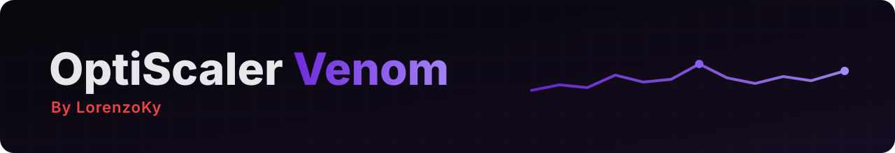

  

 

  

 

  
  
  
  

 

**OptiScaler Venom** (by LorenzoKy) is a community build of [OptiScaler](https://github.com/optiscaler/OptiScaler) that follows the latest upstream development and adds various features and additions that are unlikely to be seen in the regular Optiscaler.

> [!NOTE]
> This is an unofficial build. Please don't report issues with it to the OptiScaler team: open them [here](https://github.com/LorenzoKy/Optiscaler-Venom/issues) instead. If a problem also happens with the official [nightly](https://github.com/optiscaler/OptiScaler/releases/tag/nightly), it's an upstream one.

## ✨ What's different

| | Upstream OptiScaler | OptiScaler Venom |
| --- | :---: | :---: |
| Upscalers, frame generation, spoofing | ✅ | ✅ (same code) |
| FPS overlay: FPS, frame time, upscaler time | ✅ | ✅ |
| Average, 1% and 0.1% low FPS | | ✅ |
| PC latency (PresentMon style, experimental) and render latency | | ✅ |
| Bottleneck from GPU usage and CPU wait: GPU / CPU / FPS limit / V-Sync | | ✅ |
| Real refresh rate, VRR aware (experimental) | | ✅ |
| VRAM, GPU, CPU and RAM telemetry, CPU & GPU usage % | | ✅ |
| Date, time and session timer | | ✅ |
| Upscale ratio with FSR 4 model / DLSS preset | | ✅ |
| Fonts, colors, outline, rounding, row order, any screen position | | ✅ |
| Ready-made overlay presets, copy/paste settings code | | ✅ |

With the default settings the overlay looks exactly like upstream's: nothing changes until you turn something on.

## 📦 Installation

1. Download the latest `.7z` from [**Releases**](https://github.com/LorenzoKy/Optiscaler-Venom/releases/latest).
2. Install it like regular OptiScaler: extract it next to the game's executable and rename `OptiScaler.dll` (for example to `dxgi.dll`). The full guide is in the [OptiScaler wiki](https://github.com/optiscaler/OptiScaler/wiki).
3. Already using OptiScaler? Replace only `OptiScaler.dll` (renamed as before) and keep your `OptiScaler.ini`: the new overlay keys fall back to their defaults. To have them documented in your ini, take the one from the archive.

## 🌙 Nightly builds: always up to date, not tested

There are two kinds of downloads:

| | Stable releases | Nightly builds |
| --- | --- | --- |
| What | A version checked by me before publishing | The **official OptiScaler nightly of the day** + the Venom changes, built automatically |
| OptiScaler code | Upstream of the release date | The latest upstream changes, every day |
| Tested in game | ✅ | ❌ **Not tested** |
| Where | [**Latest release**](https://github.com/LorenzoKy/Optiscaler-Venom/releases/latest) | [**Pre-releases**](https://github.com/LorenzoKy/Optiscaler-Venom/releases) named `OptiScaler Venom nightly YYYYMMDD` |

> [!WARNING]
> **Nightly builds are the way to always have OptiScaler's most recent changes, but nobody tests them.** They are built by a script every day from the [official nightly](https://github.com/optiscaler/OptiScaler-nightly/releases): if upstream breaks something, the nightly breaks too. Use them if you want the newest fixes and can live with bugs; otherwise stick to the stable releases. If a day's upstream changes conflict with the Venom ones, that day has no nightly.

Every nightly says exactly what it's made of: the upstream nightly and commit with their dates, and the Venom commit. The full list is in the [changelog](CHANGELOG-Opti-Venom.md#nightly-builds). Only the last 14 nightlies are kept.

## 🎛️ Using the overlay

Open the OptiScaler menu (`Insert` by default) and go to **FPS Overlay**:

- **Presets**: *Opti-Like*, *Afterburner-Like* and *Latency Lab*, one click to apply, **Save Settings** to keep.
- **Rows** and **Metric Options**: choose what to show, in which order, and how (latency type, lows, CPU & GPU usage, session timer, hardware names, compact labels).
- **Appearance**: font, size, colors, shadow or outline, background, corner radius, position (corners, centers or custom X/Y).
- **Share Settings**: **Copy Code** puts your setup in the clipboard to share it, **Paste Code** applies someone else's.

Every option is also an `FpsOverlay*` key in `OptiScaler.ini`, each one documented there.

> [!TIP]
> **PC latency** needs a game with Reflex, XeLL or AntiLag 2. It's an estimate close to FrameView and PresentMon: expect a few milliseconds of difference, since the overlay can't see the display's flip.

## 📜 Changelog

See [**CHANGELOG-Opti-Venom.md**](CHANGELOG-Opti-Venom.md). Every stable release says which upstream OptiScaler version and commit it's built on, and every nightly build is listed there with its upstream nightly, commits and dates.

## 🙏 Credits

- **[OptiScaler](https://github.com/optiscaler/OptiScaler)** and its team and contributors (cdozdil, FakeMichau, TheRazerMD and everyone else): this build is entirely based on their work. If you like it, [support OptiScaler](https://github.com/sponsors/cdozdil?frequency=one-time).
- **[LorenzoKy](https://github.com/LorenzoKy)**: FPS overlay rework and the OptiScaler Venom builds.
- The third-party libraries and SDKs OptiScaler uses, listed in the [original README](README-OptiScaler.md).

## ☕ Support

OptiScaler Venom is free and always will be. If it's useful to you and you'd like to say thanks, you can [buy me a coffee on Ko-fi](https://ko-fi.com/lorenzoky): completely optional, and appreciated. Supporting the [OptiScaler team](https://github.com/sponsors/cdozdil?frequency=one-time) helps the project this build is made of.

## ⚖️ License

GPL-3.0, like OptiScaler: see [LICENSE](LICENSE). The full source code of every release is in this repository, tagged with the release's version.
